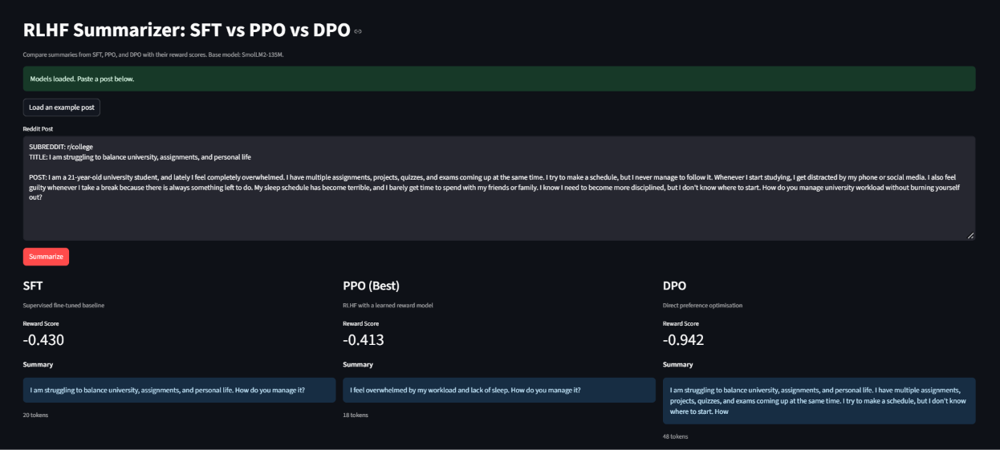

# RLHF-Summarizer-from-scratch

A small, readable implementation of the full RLHF pipeline for Reddit TL;DR summarization, written from scratch in PyTorch. It trains a 135M-parameter model through four stages and compares two ways of learning from human preferences, **PPO** (with a learned reward model) and **DPO** (no reward model).

Everything runs on a single Tesla T4 (Google Colab is enough).

```
 SmolLM2-135M
      │
      ▼
 ┌─────────┐      ┌──────────────┐      ┌─────────┐
 │  SFT    │ ───► │ Reward Model │ ───► │  PPO    │
 └─────────┘      └──────────────┘      └─────────┘
      │
      └──────────────────────────────►  ┌─────────┐
                                        │  DPO    │
                                        └─────────┘
```

## Setup

| Item | Value |
|---|---|
| Base model | `HuggingFaceTB/SmolLM2-135M` |
| SFT data | `CarperAI/openai_summarize_tldr` |
| Preference data | `CarperAI/openai_summarize_comparisons` |
| SFT train / val | 20,000 / 500 |
| Preference train / val | 20,000 / 1,000 |
| Evaluation posts | 300 |
| Max prompt / summary length | 448 / 48 tokens |
| Precision | fp32 |
| Seed | 42 |

Posts are cleaned to `SUBREDDIT / TITLE / POST` followed by a fixed `TL;DR:` marker the model learns to continue. Examples longer than the token limits are dropped.

## Repository structure

```
.
├── starter/
│   ├── config.py          # model name, datasets, split sizes, length limits
│   ├── data.py            # cleaning, filtering and tokenising SFT / preference / eval data
│   ├── batching.py        # collate functions (SFT, preference pairs, left-padded prompts)
│   ├── models.py          # tokenizer and causal LM loaders
│   └── check_starter.py   # sanity check for the data pipeline
├── common.py              # token_logprobs, summary_mask, generate_summaries
├── test-common.py         # tests for the helpers in common.py
├── train_sft.py           # Stage 1: supervised fine-tuning
├── train_reward.py        # Stage 2: reward model
├── train_ppo.py           # Stage 3a: PPO with KL penalty and value head
├── train_dpo.py           # Stage 3b: DPO
├── evaluate.py            # compares SFT / PPO / DPO on held-out posts
├── app/app.py             # Streamlit demo
├── notebook.ipynb         # end-to-end Colab notebook
└── results/               # logs, tables, figures and analysis
```

## Pipeline

**1. SFT** (`train_sft.py`): fine-tunes SmolLM2-135M on TL;DR summaries. The loss is computed on summary tokens only (via `summary_mask`). AdamW, lr 5e-5, batch size 16, gradient checkpointing.

**2. Reward model** (`train_reward.py`): the SFT backbone with a linear head on the last token's hidden state. Trained with the Bradley–Terry pairwise loss `-log σ(r_chosen − r_rejected)`. lr 1e-5, batch size 8, 2,500 steps.

**3a. PPO** (`train_ppo.py`): policy with a linear value head on the same backbone, plus a frozen reference model and the frozen reward model. The per-token reward is `−β_KL · (log π_θ − log π_ref)`, with the reward model score added on the last token.

| Hyperparameter | Value |
|---|---|
| Iterations | 200 (16 prompts each) |
| PPO epochs per rollout | 4 |
| Clip ε | 0.2 |
| β_KL | 0.05 |
| Value / entropy coefficients | 0.1 / 0.01 |
| Learning rate | 1e-5 |
| Max new tokens | 48 |

**3b. DPO** (`train_dpo.py`): trains the policy directly on preference pairs against a frozen SFT reference, using the implicit reward `β log(π_θ / π_ref)`. β = 0.1, lr 2e-6, batch size 8 (micro-batch 4), 2,500 steps.

**Evaluation** (`evaluate.py`): greedy decoding on 300 held-out posts, scored with the reward model. Reports mean reward, KL to SFT, length, ROUGE-L and win rate against SFT.

## Quickstart

### Colab (recommended)

Open `notebook.ipynb` in Colab with a GPU runtime. It installs dependencies, clones the repo and runs every stage in order.

### Local

```bash
git clone https://github.com/musfiraumar/RLHF-Summarizer-from-scratch.git
cd RLHF-Summarizer-from-scratch

pip install torch transformers datasets accelerate matplotlib tqdm sentencepiece huggingface_hub rouge_score streamlit

python starter/check_starter.py   # check the data pipeline
python train_sft.py               # -> checkpoints/sft
python train_reward.py            # -> checkpoints/reward
python train_ppo.py               # -> checkpoints/ppo
python train_dpo.py               # -> checkpoints/dpo
python evaluate.py                # -> results/eval_summaries.jsonl
```

Run the stages in this order: the reward model and DPO need the SFT checkpoint, and PPO needs both the SFT and reward checkpoints. `checkpoints/` is git-ignored.

### Pretrained checkpoints

`evaluate.py` and the demo app download any missing checkpoints (SFT, reward, PPO, DPO) from the Hugging Face repo `Musfirah-umar/Rlhf-summarizer`, so you can evaluate or demo without retraining.

### Demo app

```bash
streamlit run app/app.py
```

Paste a Reddit post and compare the summaries from the SFT, PPO and DPO models side by side, each with its reward model score and token count.



## Results

### Training

| Stage | Final train loss | Validation metric | Time (Tesla T4) |
|---|---:|---:|---:|
| SFT | 2.3905 | 2.4447 loss | 89.5 min |
| Reward model | 0.6911 | 53.4% accuracy | 129.7 min |
| PPO | −0.0281 (policy loss, iter 200) | −0.527 mean RM score (last 20 iters) | 60.8 min |
| DPO | 0.6096 | 60.9% implicit-reward accuracy | 205.7 min |

DPO validation accuracy rose from 58–59% early in training to a peak of 61.9% (step 2250) and ended at 60.9%.

### Evaluation on 300 held-out posts (greedy decoding)

| Model | Mean RM score | KL to SFT | Mean length | ROUGE-L | Win rate vs SFT |
|---|---:|---:|---:|---:|---:|
| SFT | −0.556 | 0.00 | 30.4 | 0.253 | n/a |
| PPO | −0.513 | 0.41 | 21.5 | 0.241 | 52.3% |
| DPO | −0.713 | 4.03 | 44.2 | 0.223 | 48.3% |

Win rates are judged by the reward model. With 300 posts the 95% interval is about ±5.7 points, so neither is distinguishable from 50%.

### Human evaluation

Two members each picked the best of the three summaries (shown in random order, model names hidden) on 30 evaluation posts. Sheet: `results/human_eval.csv`.

| Picked as best | Member 1 | Member 2 | Both (60 picks) |
|---|---:|---:|---:|
| SFT | 11 | 13 | 24 (40.0%) |
| PPO | 14 | 9 | 23 (38.3%) |
| DPO | 5 | 8 | 13 (21.7%) |

The members agreed on 15 of 30 posts (50.0%, kappa ≈ 0.24). SFT and PPO are not separated; DPO was picked least by both members.

### Key findings

- **The reward model is weak.** It reaches 53.4% accuracy on 1,000 validation pairs (49.7% before training), barely above chance. Its training loss stayed near ln 2 ≈ 0.693.
- **PPO barely improved the reward.** The mean score moved by about +0.025 between the first and last 20 iterations, about the size of the noise, while KL to SFT grew from about 1.2 to 5 nats and summaries shrank from about 34 to 25 tokens.
- **The reward model seems to favour short outputs.** Reward and length are weakly negatively correlated (r = −0.28) during PPO, and DPO's longer summaries got the lowest reward model score.
- **The PPO clip rarely binds.** The mean clip fraction is 0.027, and `epoch0_clip` is exactly 0 as expected, so drift came from many small steps rather than a few large ones.
- **DPO is simpler to run** (two models in memory, no sampling loop or value head) but was not faster overall (about 295 min vs 280 for PPO), and it drifted toward longer outputs here.
- **Humans did not prefer PPO.** In the 30-post human evaluation PPO and SFT were picked about equally (23 vs 24 of 60 picks), and DPO was picked least (13 of 60). 190 of 300 DPO summaries hit the 48-token limit.

A higher reward model score is not evidence of better summaries in this run. See [`results/Analysis.md`](results/Analysis.md) for the full discussion, including the role of β_KL, the DPO derivation and a memory/time comparison.

## Results folder

| File | Contents |
|---|---|
| `results/Analysis.md` | Written analysis of all stages |
| `results/tables/table1_data.md` | Dataset statistics |
| `results/tables/table2_training.md` | Training summary |
| `results/figures/figure1_sft_loss.png` | SFT loss curve |
| `results/figures/figure2_reward_training.png` | Reward model training |
| `results/sft_log.json`, `reward_log.json`, `ppo_log_fp32.json` | Raw training logs |
| `results/reward_mistakes.json` | First 20 validation pairs the reward model got wrong |
| `results/eval_summaries.jsonl` | Per-post summaries and scores for SFT / PPO / DPO |
| `results/human_eval.csv`, `human_eval_key.csv` | Blinded human evaluation sheet (30 posts) and its answer key |

## Limitations

- The model is small (135M) and the reward model is close to chance, so PPO and DPO comparisons are noisy.
- The human evaluation is small (30 posts, 2 members, 50% agreement), and the 300-post win rates come from the reward model.
- Each configuration was run once with one seed (42).

## Acknowledgements

Built on the OpenAI TL;DR summarization datasets (via CarperAI on Hugging Face) and the SmolLM2 model from Hugging Face. The method follows *Learning to Summarize from Human Feedback* (Stiennon et al., 2020), PPO (Schulman et al., 2017) and DPO (Rafailov et al., 2023).